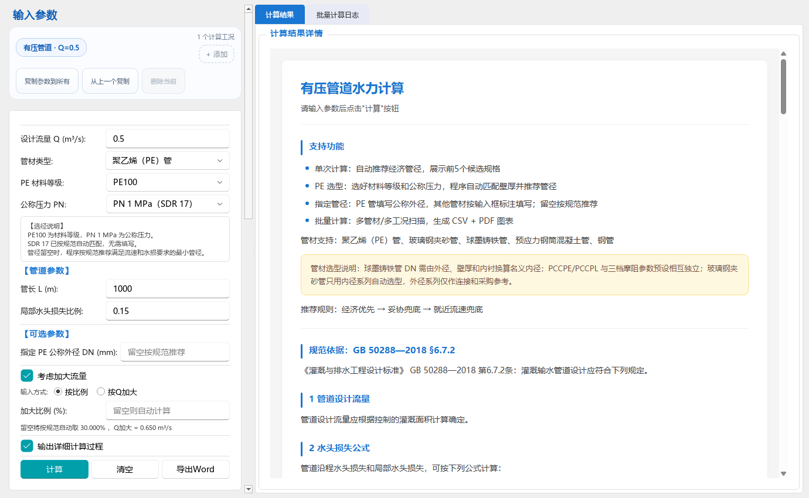

# 有压管道首次进入与稳定性核验

> 后续状态：本记录保留第一轮的源码指纹与验收时点。文末列出的表3交互和保存触发隐藏页面创建问题，已在[第二轮核验](表格交互与项目保存优化核验_20261009.md)中处理；当前行为以第二轮记录及对应 PRD 为准。

核验日期：2026-10-09。用户确认主要卡顿发生在每次启动后第一次切换到“有压管道设计”页。本轮修订保留现有水力算法、产品目录、候选排序、数值精度和工程文件格式。

## 已处理的问题

| 问题 | 原因及修改 | 核验方式 |
|---|---|---|
| 首次进入有压页阻塞 | 页面导入内核时提前导入 pandas 和 scipy.optimize；分别改为实际批量任务和实际无压求解时加载 | 独立进程依赖断言；真实 Qt/WebEngine 5 次前后对照 |
| 首次显示覆盖已恢复成果 | 延迟帮助回调未检查已有成果或错误页；改为检查当前输出、页面可见性，使用随面板销毁的单次定时器 | 成功结果、错误结果恢复后首次显示；快速离开再进入 |
| 多工况结果恢复异常 | 钢管专项判定直接访问兼容输入中可能不存在的材料字段 | 原始 HEAD 同样复现两项失败，补上字段缺失容错后复测 |
| 公式缓存长期增长 | 原共享 SVG 字典无限保存不同代入值，失败项也会被反复渲染 | 限制最近使用的 512 项；验证淘汰顺序、SVG 复用及失败缓存 |
| 坡度区重复布局 | 每次尺寸变化都重新添加全部标签 | 仅跨两列/三列断点时重排；复用窄/普通/宽侧栏布局回归 |
| 保存中途失败损坏原工程 | 直接截断目标文件再写入，面板收集失败还会静默省略 | 同目录临时文件完整写入后替换；失败保留原文件与未保存状态；数据收集失败阻断覆盖 |

## 性能测量口径

- 基准：Git 提交 `7da3a28accee9d361d240f27739ef4bedadc365d`；只在子进程中装载本轮相关模块的历史源码，不修改工作区。
- 场景：明渠首页已经显示并完成网页加载，随后导入、创建并切换至有压管道页，计时至其真实 WebEngine 报告加载完成；不计等待截图合成帧的时间。
- 环境：本机 Windows、项目 Python 3.13.3 / PySide6 6.11.0、Qt 离屏、真实 WebEngine、1380 × 850 窗口。每组使用 5 个独立进程，统计中位数；字体、依赖、参数和窗口尺寸一致。
- 首次与重复切换分开记录。页面创建和网页渲染时间仍计入首次进入总时间；耗时库没有被移到程序启动时预热，普通有压单次选径也不加载它们。
- 原始样本、源码 SHA-256 和统计结果见 [性能记录 JSON](../qa/pressure_pipe_performance_20261009.json)。下表为最终复测；总耗时的中位数按每个样本总时间计算，不把各阶段的中位数相加。

| 项目 | 修订前中位数 | 修订后中位数 |
|---|---:|---:|
| 首次进入至网页加载完成 | 1.154 秒 | 0.368 秒 |
| 页面模块导入 | 0.799 秒 | 0.024 秒 |
| 重复切换 | 0.012 秒 | 0.012 秒 |

首次进入总耗时减少约 **68.1%**。两组所有页面均成功加载；修订前首次进入都会新增加载 pandas/scipy.optimize，修订后均未加载。离屏截图检查了参数区、工况区、操作按钮和帮助页的中文显示及滚动承载，当前可见区域未见重叠或截字；此检查不等于用户桌面或打包版验收。



复测命令：

```powershell
.\.venv\Scripts\python.exe tools\benchmark_pressure_pipe_switch.py --repeat 5 --baseline-ref 7da3a28accee9d361d240f27739ef4bedadc365d --output docs\qa\pressure_pipe_performance_20261009.json
```

## 回归范围与结论

关联检查覆盖有压管道计算、PE/球墨铸铁/PCCP/玻璃钢目录、钢管选径、无压求解、CSV/PNG/PDF 批量输出、工况结果恢复、多工况导航、公式 SVG、主窗口按需加载，以及保存失败保护。测试逐文件独立运行，以隔离已有测试中的全局 Qt 替身；发生修订的用例另作定向复测。

最终 **22 个测试文件、403 项不同测试通过，0 项失败**。首轮为 401 通过、2 失败；这两项在原始 HEAD 中也失败，修复材料字段缺失处理后，涉及的三个文件联合复测 115 项全部通过；保存入口补充复测 4 项通过。复测与首轮重合的用例不重复计数。完整清单及分轮结果见 [回归记录 JSON](../qa/pressure_pipe_regression_20261009.json)。

新增测试文件：`test_pressure_pipe_first_entry_unit.py`、`test_formula_cache_lifecycle_unit.py`、`test_project_atomic_save_unit.py`。

## 范围与后续事项

- 本轮实测结论是当前源码在上述环境下的首次进入提速；没有执行正式发版、安装包更新或用户现有桌面会话验收。
- 共享公式缓存的条目数已受限；没有把该检查表述为全程序长时间内存泄漏验收。
- 工程保存仍会实例化未访问的模块，加载流程也依赖完整面板状态。后续若改为只收集已打开模块，必须同时处理未实例化数据的保留、同会话切换工程时的清空以及管理器恢复，不能仅把未打开模块写成空值。本轮保留该契约，完成保存失败保护。
- 表3窗口缩放仍有全表列宽测量，批量删除仍逐格触发下游联动。它们不是本次用户确认的首开场景，已记录为后续需要真实大工程基线的优化项；未声称全仓库所有卡顿和潜在缺陷均已消除。
- 本轮临时验证目录 `tools/_tmp_test_outputs/pressure_perf_20261009` 的删除被自动审批策略拒绝，返回理由为 `blocked by policy`；目录仍保留。该限制不影响上述源码修改、测试结果和已保存的正式核验资料。
