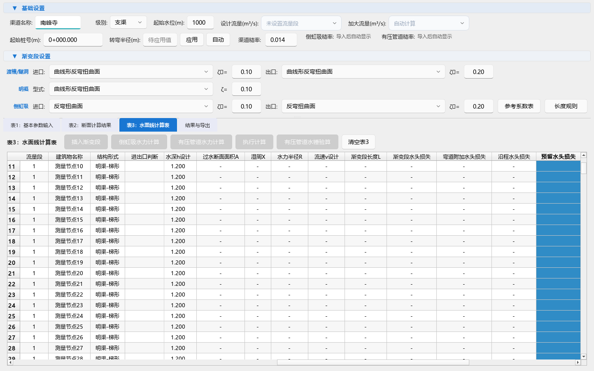

# 表格交互与项目保存优化核验（2026-10-09）

> 后续状态：本记录保留第二轮测量时点及源码指纹。表1编辑、修改通知、工况导航销毁和稀疏工程打开的后续变化见 [第三轮核验](表1编辑与稀疏工程打开优化核验_20261009.md)；当前行为以最新 PRD 为准。

## 结论与范围

本轮完成表3缩放、单元格选择、批量删除，以及保存触发隐藏页面创建的优化，并修复撤销人工水损与工程重置的关联缺陷。源码及对应 PRD 已同步；尚未执行正式发版或打包版桌面验收。

性能比较使用本机 Windows、Python 3.13.3、PySide6 6.11.0、真实 Qt 表格控件。窗口在离屏平台运行，结果网页使用 QTextBrowser；这组数据不代表网页加载性能。表格为 400 行、44 列的合成交互样本，不用于实际工程设计复核。

## 已完成的行为修订

- **列宽与选择：** 将内容宽度测量和视口空间分配分开。连续缩放采用随表格销毁的 80 毫秒单次计时器合并；内容、表头、行列结构、字体和列显隐变化时使缓存失效。选择单元格只记录原文，实际编辑再生成撤销快照。
- **批量删除：** 保留逐格合法性处理、精度缓存失效及人工覆盖标记；所有修改完成后先更新各受影响行的总损失，再统一递推下游累计损失、水位和高程。控件刷新与工程修改通知各一次，整组仍是一条撤销记录。
- **撤销一致性：** 修复表格已恢复但节点中的有压水损人工采用值仍为删除后数值的问题，同时恢复过闸标记及渐变段来源信息。撤销/重做后更新原地继续编辑所用的旧文本，并标记工程待保存。
- **保存懒加载：** 手动保存、另存为及自动保存只收集现有面板，未创建模块保留原 JSON 空槽位，不为保存打开其他页面。打开文件继续完整恢复已注册模块，保证已有项目数据进入面板后可再次保存。
- **工程重置与旧版兼容：** 新建及打开缺失模块的工程时重置已有页面，清除旧结果和旧撤销记录；水面线保留原新建规则中的空基础信息、首个级别、桩号 0 与糙率 0.017。仅包含旧批量面板的工程同时恢复可见渠道信息和输入表，已验证重存。
- **恢复保护：** 批量线程运行中不切换工程。已注册面板恢复失败时尝试回退到原状态；回退失败则暂停保存，直到成功重开或新建。继续保留上一轮同目录临时文件替换的保存保护。

## 五轮独立进程计时

历史对照只替换基准工具列出的7个前端模块为 Git `7da3a28accee9d361d240f27739ef4bedadc365d` 源码，其余依赖使用相同工作区与环境。每个场景的修订前、修订后各取5个独立进程，以中位数统计。最终修订又复测当前源码，保留了原历史样本和被替代的中间样本。

| 场景 | 修订前中位数 | 修订后中位数 |
|---|---:|---:|
| 连续12次窗口缩放，至列宽调整完成 | 1.054 秒 | 0.297 秒 |
| 100次切换当前单元格 | 3.750 秒 | 0.003 秒 |
| 清空80个损失单元格 | 14.572 秒 | 0.217 秒 |
| 仅访问明渠后，首次保存的数据收集 | 3.216 秒 | 0.002 秒 |

保存一行仅统计数据收集阶段，不包括磁盘写入和文件对话框时间。保存前只有明渠面板存在；旧流程收集后创建了全部8个面板，新流程始终只有1个面板，明渠序列化数据逐项一致。

表格的各轮行为计数保持一致：

| 检查项 | 修订前 | 修订后 |
|---|---:|---:|
| 12次缩放中的内容宽度扫描 | 12次 | 0次（复用已有测量） |
| 100次选格中的整表快照 | 100次 | 0次 |
| 删除80格时刷新有压控件 | 80次 | 1次 |
| 删除80格时工程修改通知 | 80次 | 1次 |
| 一次批量删除对应的撤销记录 | 1条 | 1条 |

修订前后最终表格文本、全部行隐藏元数据和节点序列化结果的 SHA-256 完全相同；原始样本、列宽、状态指纹及最终源码指纹见 [性能记录](../qa/table_interaction_performance_20261009.json)。表格模型有变化时重新测量列宽的行为另由回归验证，不能把“0次扫描”理解为永久停止测量。

早期基准进程在退出阶段曾出现原生异常，其数据未纳入正式统计。验证工具改为先销毁测试窗口，再退出进程，之后正式统计批次均正常退出；此处理属于验证工具的释放顺序，不据此宣称修复了生产程序的退出问题。

## 回归与静态检查

最终 **24个文件、312项不同测试通过，0项失败**。范围包括真实表格控件、冻结列与只读删除、列宽缓存失效、同格连续编辑、人工水损覆盖、撤销/重做、渐变段详情及门禁、表1表3同步、工程保存失败保护、旧工程重开、多工况恢复、倒虹吸参数与几何、以及第一轮有压页面的首次进入保护。

正式首轮为260项通过、51项失败；51项来自两个纯状态测试文件的样式替身缺少新增窗口调度入口。将调度函数移到真实 resizeEvent 使用处导入后，两文件51项全部通过。随后补充旧版批量工程可见基础信息的真实恢复测试并通过；重复执行的用例不重复计数。完整分轮记录见 [回归记录](../qa/table_interaction_regression_20261009.json)。

AST语法解析通过。源码差异检查无空白错误。正式回归前后，用户自动存档文件的 SHA-256 一致；工作区观察到的其他修改予以保留。并发 Word 导出工作的改动不归入本轮性能修订的范围或验证结论。

本轮独立临时测试目录随每次执行清理完成。上一轮临时目录的清理限制仍见上一轮记录，本轮未对该目录再次操作。

## 可复测入口

完整性能对照：

```powershell
.\.venv\Scripts\python.exe tools\benchmark_table_interactions.py --runs 5 --baseline-ref 7da3a28accee9d361d240f27739ef4bedadc365d --output docs\qa\table_interaction_performance_20261009.json --screenshot docs\qa\table_interaction_panel_20261009.png
```

新增回归文件为 `tests/test_table_interaction_performance_unit.py` 与 `tests/test_project_lazy_save_unit.py`。正式关联回归按文件分别启动 Python 进程，避免既有测试中全局 Qt 替身相互污染；每个进程先初始化应用运行环境与 QFluentWidgets 兼容层，设置离屏及 QTextBrowser 环境，使用独立 pytest 临时目录。其他文件清单与结果保存在回归 JSON 中。

## 界面检查与交付边界

下图来自最终源码的真实 Qt 离屏窗口。检查了当前可见区域的中文、表头、冻结列、横向滚动和批量删除选择区，未见新增重叠或截字。44列通过水平滚动承载，本图没有把全部列同时压缩到窗口中。



当前交付是源码修改。现有安装包需重新构建才能包含这批修订，运行中的旧进程需保存工程后重启。打开工程仍完整装配页面，长时间桌面会话、安装包性能及全仓库所有潜在缺陷不在本轮验收结论之内。

相关说明：[水面线PRD](../PRD_推求水面线.md)、[项目保存PRD](../PRD_项目保存功能.md)、[合并面板PRD](../PRD_合并批量计算与水面线面板.md)、[倒虹吸PRD](../PRD_倒虹吸水力计算.md)、[项目管理现状PRD](../PRD_项目管理按钮功能现状_AsIs_V1.0.md)。
